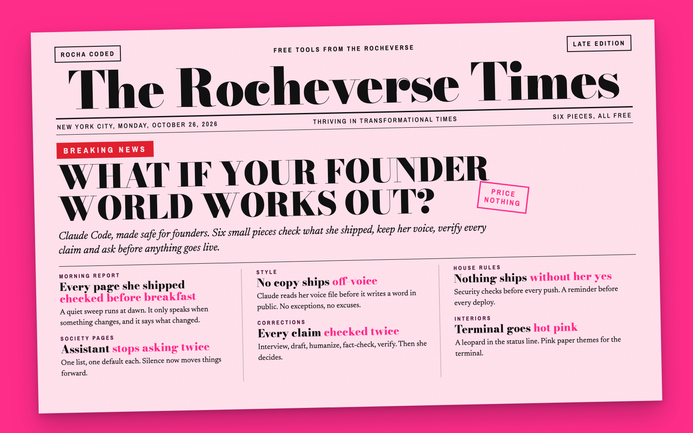

# Claude Code for Founders

*Free tools from the Rocheverse.* Part of the **Rocha Coded** collection.




*Same words, three looks: analog, cyberpunk, y2k blog. You pick yours with one line in your style file, and your colours re-tone all three.*

**Claude Code, made safe for founders.**

You build with it. What you shipped keeps working, and you hear about it the morning it doesn't.
It never asks you the same question twice.
It never writes in a voice that isn't yours.
It never ships a claim you can't stand behind, and never pushes anything you didn't say yes to.
And it looks good doing it.

Six small pieces. Take one. Take all six. Each one installs on its own and comes out again as cleanly.

## Start here
New to the terminal? You are in the right place. Five steps, one at a time, and each one tells you what you will see when it worked.

The **terminal** is the app where you type instructions to your computer. On a Mac, press Cmd and Space together, type Terminal, and press Return.
A **command** is one line you type (or paste) into the terminal, then press Return.
**Claude Code** is Claude working on your computer, in the terminal or in the Claude desktop app.

&nbsp; Check your computer has the two tools the kit needs, git and Python.
```sh
git --version && python3 --version
```
You will see two version numbers, like `git version 2.39` and `Python 3.12`. If a box pops up offering to install developer tools instead, click Install, wait for it to finish, and run this step again.

&nbsp; Download the kit. To **clone** means to download your own copy of a project from GitHub, ready to update later.
```sh
git clone https://github.com/RochaStone/claude-code-for-founders ~/.claude/skills/claude-code-for-founders
```
You will see `Cloning into ...` and then your cursor again.

&nbsp; Go to the kit's folder. `cd` means "change folder", and `~` means your home folder.
```sh
cd ~/.claude/skills/claude-code-for-founders
```
You will see nothing at all, and that means it worked.

&nbsp; Check everything works on your computer. This runs every test in throwaway folders and changes nothing of yours.
```sh
./scripts/run-tests.sh
```
After about a minute you will see `ALL TESTS PASSED (6 suites)`.

&nbsp; Pick your first piece from the table below and open its folder's README. Never ask twice is a lovely first one.
Or start Claude Code (type `claude` and press Return) and say: "help me install never ask twice". It walks you through it, one question at a time.


## The six pieces

| Piece | What you get | Installs |
|---|---|---|
| [Goal tests](goal-tests/) | Everything you shipped, checked every morning. One notice when something breaks, with what changed. Silence when nothing did. | a daily job on your computer |
| [Never ask twice](never-ask-twice/) | One list of everything open, each item with a default. Unanswered questions get the default, not a second ask. | a session-start hook |
| [Voice gate](voice-gate/) | Claude can't write your public copy until it has read how you sound. | two hooks |
| [Copy gate](copy-gate/) | Interview, draft, humanize, fact-check, verify. Five skills between a draft and the internet. | five skills |
| [Standards](standards/) | The house rules an engineer would insist on, plus the scripts that check them before anything leaves your computer. | files in your project, an optional hook |
| [Pink terminal](pink-terminal/) | A plum and cream status line with a leopard in it, terminal themes and a wallpaper, all in your own colours if you like. | a status line, themes |


## Where it runs
This kit runs in **Claude Code on your computer**: the terminal or the Claude desktop app, on a Mac or Linux.
Hooks, a daily job and a status line live on your machine, so that is where they belong.
The copy-gate skills also work in **Claude Cowork** as uploaded skills.

You need Python 3, which most Macs already have. If one is missing, run `xcode-select --install`.


## Install

| Where you use it | Install it | Start it |
|---|---|---|
| [Claude Code](#claude-code) (recommended) | clone into `~/.claude/skills`, run one piece's installer | ask: "help me install the voice gate" |
| [Claude Cowork](#claude-cowork) | upload the copy-gate skill zips | ask: "interview me before you write this" |

### Claude Code
```sh
git clone https://github.com/RochaStone/claude-code-for-founders ~/.claude/skills/claude-code-for-founders
cd ~/.claude/skills/claude-code-for-founders
```
Then install the pieces you want, one at a time:
```sh
./goal-tests/install.sh
./never-ask-twice/install.sh
./voice-gate/install.sh
./copy-gate/install.sh
./standards/install.sh ~/Projects/my-app
./pink-terminal/install.sh
```
Or let Claude do it. Start Claude Code and say "help me install never ask twice". The kit's own skill walks it through, one piece at a time, showing you each change first.

To update later: `git -C ~/.claude/skills/claude-code-for-founders pull`, then re-run the installers you use.

### Claude Cowork
1. Build the skill zips: `./copy-gate/install.sh --zip`. They land in `dist/copy-gate/`.
2. In the Claude desktop app: Customize > Skills, then + > Upload a skill. Upload each zip.
3. In a Cowork task, ask: "Interview me before you write my launch email."

After the first release, you can skip building: download the five skill zips from the [latest release](https://github.com/RochaStone/claude-code-for-founders/releases/latest).


## Make it yours
One file, `style.json`, holds your colours, fonts and words. Put it in your working folder or at `~/.rocha-coded/style.json`, and the terminal wears your look instead of mine.
Two examples ship: `examples/style.rocha-coded.json` (my look) and `style.example.json` (blank, explained key by key in [STYLE.md](STYLE.md)).
Your palette and fonts set the colour and type. Your `motif` (analog, cyberpunk or y2k-blog) sets the structure. Both are yours to curate.
The same file works across every Rocha Coded tool, so you make it once.


## Every installer makes the same promises
- **Backup first.** `~/.claude/settings.json` is copied to a dated backup before anything changes.
- **Never breaks your settings.** If the file isn't valid JSON, nothing is written.
- **Safe to run twice.** Running an installer again changes nothing it already did.
- **Never overwrites yours.** Your config, your lists, your skills with the same name all stay.
- **Comes out cleanly.** Every piece has `--uninstall`, and it only removes what this kit added.


## Proof it works
Every piece ships with its own tests. Run them all:
```sh
./scripts/run-tests.sh
```
They run in throwaway folders and never touch your real `~/.claude`.


## Why this exists
Each piece is a rule I set after something went wrong in my own work with Claude Code.
A page that quietly broke. A question I missed and never saw again. A paragraph that sounded like nobody.
Rules nothing enforces get skipped on a busy day. So I made them enforce themselves.
This didn't exist, so I built it.

*The future doesn't belong to founders who become more like AI. It belongs to the ones who leverage AI to amplify more fully themselves.*


## If it goes wrong (everyone's first time) 
This happens to everyone the first time. Here are the three most common ones.
- **"command not found: git" or "command not found: python3".** Your Mac needs its developer tools. Type `xcode-select --install`, press Return, click Install in the box that appears, then try again.
- **"Permission denied" when you run a script.** Put `bash` in front of it, like `bash ./scripts/run-tests.sh`. It does exactly the same thing.
- **"destination path already exists" when you clone.** You already have the kit. Skip to step 3, then update it with `git pull`.


## Licence
MIT. See [LICENSE](LICENSE).

[Sign my guestbook](https://github.com/RochaStone/claude-code-for-founders/issues) ✧ say hello, ask a question, or tell me what you built.


## Made by Rocha

Rocha \
Brand Alchemist & AI Architect \
Author of *Brand Alchemy in the Thriving Era* and *Thriving in Transformational Times* \
Creator of [Conscious Founder Operating System](https://founders.thrivingera.com) \
Founder, [Thriving Era Studio](https://thrivingera.com)

I help female founders build their founder world, and I build what they need next. \
Start with the audit: [thrivingera.com/audit](https://thrivingera.com/audit). \
Or book an exploratory call: [calendly.com/rochelle-thrivingera/exploratory-call](https://calendly.com/rochelle-thrivingera/exploratory-call). It is where we decide if we work together.

[Instagram @rocheverse](https://instagram.com/rocheverse) · [Substack](https://rochastone.substack.com) · [LinkedIn](https://www.linkedin.com/in/rochellelivingstonecosmic) · [More free tools](https://thrivingera.com/free) · [All tools on GitHub](https://github.com/RochaStone)
